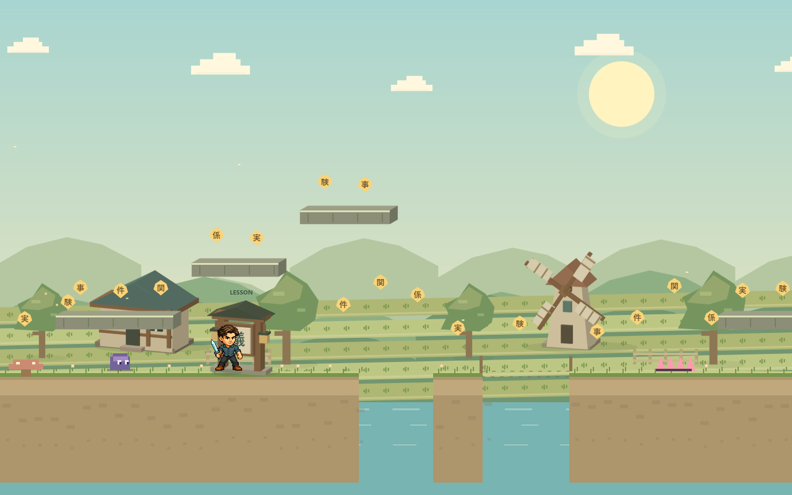

# Quest: Kotoba Trail

A small, lively Japanese-learning platformer starring **Quest**, a cheeky pixel
adventurer. Run, double jump, dash through ink slimes, collect kanji sparks, and visit
lesson shrines to build bridges through three worlds.



## Play online

**[Play Quest: Kotoba Trail](https://gamesp.xyz/quest-kotoba-trail/)** — free to
play in your browser, on desktop or mobile. No installation or account needed.
The game is hosted on GitHub Pages from the root of the `main` branch.

## Play locally

Requires Node.js 18 or newer. There are **no packages to install**.

```sh
git clone https://github.com/SafalFrom2050/quest-kotoba-trail.git
cd quest-kotoba-trail
npm start
```

Open **http://127.0.0.1:4280**. Alternatively, from this folder run
`python -m http.server 4280 --bind 127.0.0.1` and open the same URL.
Serve the folder over HTTP; browser module loading requires a local server.
Every asset, lesson, sound, and effect is local. No account, API key, or network
service is used during play.

## Controls

| Action | Keyboard | Touch |
| --- | --- | --- |
| Move | A / D or left / right arrows | Direction buttons |
| Jump / double jump | Space or W | Jump button |
| Dash | Shift or K | Lightning button |
| Open nearby shrine / portal | E or up arrow | On-screen shrine button |
| Answer | 1 / 2 / 3 or click | Tap an answer |
| Continue a lesson | Enter | Continue button |
| Pause | Escape | Pause button |
| Toggle music | M | Music button |
| Switch learning hints | Click EN / NE in the header | Tap EN / NE |

Land on pink spring pads for a boost. Stomp or dash through ink slimes.
Falling returns you to the latest shrine checkpoint; solved bridges stay open.
All three shrines must be solved to open the exit. Lessons pause the trail
and have no countdown. A wrong answer gives an explanation and another
contextual question; language mistakes never cost hearts.

## Three worlds

1. **Ricefield Trail** — 議, 論, and 関係 / 環境.
2. **Windmill Village** — 治す / 直す, 治る / 直る, and ～恐れがある.
3. **Sunset Shrine** — ～に基づいて, ～ために, and ～ように.

The field guide adds 民, ～により, 実, and 米. Thirteen lessons include
Japanese, kana/romaji, meanings, English or Romanized Nepalish memory hooks, worked
sentences, and **39 contextual practice questions**. This is a focused review
game, not a complete JLPT N3 syllabus.

## Learning hint language

**English is the default**, including for returning players who have not chosen
a language yet. Use the **EN / NE** button in the header or **Hints: English /
Nepalish** inside a lesson to switch both ways. All 13 memory notes, the practice
hint, and the field notes update immediately without restarting the lesson or
changing your answers. Japanese text, readings, and English explanations stay
available in both modes.

Your choice is saved in this browser alongside your existing progress. If browser
storage is unavailable, the setting works for the current session.

## Countryside art direction

A cozy blend of Japanese countryside and fantasy farms: rice terraces, timber
cottages, turning windmills, a waterwheel, flowers, and a sunset shrine garden.
Warm paper panels and earth colors match Quest’s original pixel identity.

The game uses selected **3D meshes** for cottage roofs and walls, windmills,
the waterwheel, shrine frames, exit gates, and raised platforms. XYZ geometry
is projected and shaded directly onto Canvas, with depth ordering and gentle
camera-dependent changes in viewing angle. Quest, terrain decoration, enemies,
and the side-scrolling gameplay remain 2D. There is no extra download or engine
dependency. Motion/FX settings freeze decorative rotations and drifting details.

## Sound and visual feedback

Web Audio synthesizes a 148-BPM chiptune loop, jump sweeps, dash sounds,
spark chimes, and answer/victory melodies. Music starts after a play gesture.
Music and sound effects have independent controls. Music softens while
reading; hidden tabs mute and pause play.

Combos, dash trails, spring bursts, bridge lights, particles, small impact
shakes, and a gentle beat pulse make milestones noticeable. The FX switch
reduces animation; system reduced-motion settings take priority. No sound
files or external music services are required.

If the browser has an installed Japanese speech voice, the worked sentence
also offers a **Listen** button. Availability and voice quality depend on the
browser and operating system.

## Practice stays separate from study checkpoints

The game stores settings, discoveries, attempts, and trail bests in this
browser's local storage (`quest-kotoba-trail.v1`). The field guide can export
a JSON practice log. Every normal answer follows teaching and is recorded
as supported practice. A discovery is a game milestone, not proof of unaided
mastery. Game practice stays separate from any external study log.

## Files and checks

- `src/content.mjs`: language pack and question explanations.
- `src/worlds.mjs`: three hand-built routes.
- `src/physics.mjs`: movement, collisions, double jump, coyote time, and dash.
- `src/engine.mjs`: gameplay, camera, pixel scenery, particles, and rendering.
- `src/audio.mjs`: procedural music and feedback sounds.
- `src/low-poly.mjs`: cached 3D geometry, projection, lighting and prop drawing.
- `src/countryside.mjs`: fields, trees, village scenery and landscape themes.
- `countryside.css`: warm countryside interface colors.
- `src/progress.mjs`: local practice data.
- `assets/`: the original Quest sprite atlas and provenance.
- `docs/`: content boundaries and validation notes.

```sh
npm run check
npm test
```

The code is buildless HTML/CSS/ES modules. A static host can serve this folder
as-is, including from a subdirectory.

See [validation notes](docs/validation.md) for checked behavior, screenshots,
and the limits of the browser checks. For automated browser checks, append
`?qa=1` to the local URL to keep QA attempts separate from player practice.
